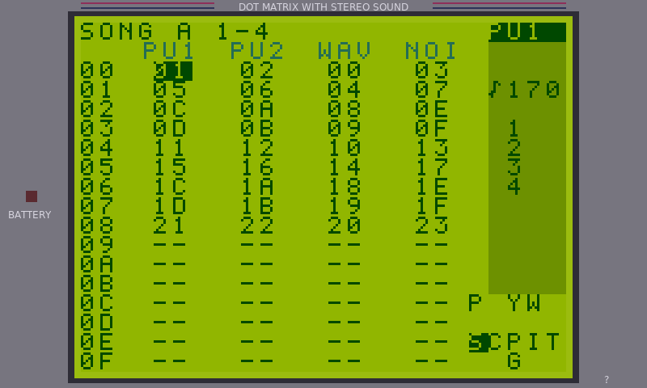
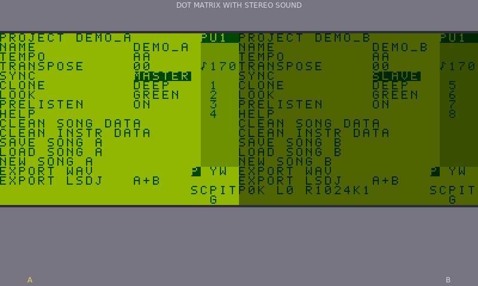
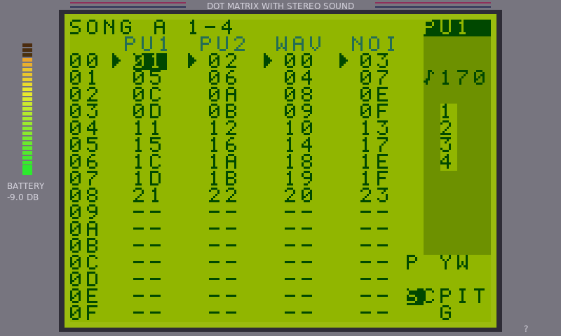
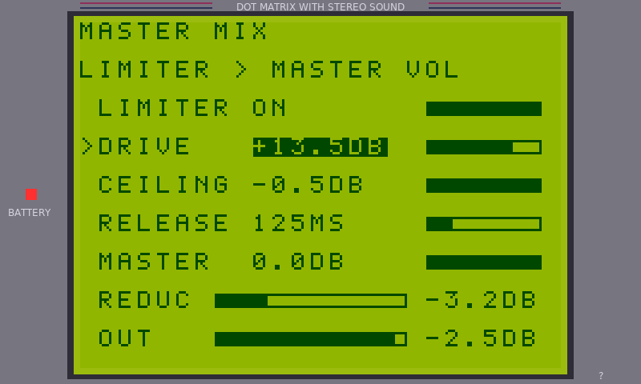

# PTSDJ

**An LSDJ-style Game Boy tracker for the original Polyend Tracker (MK66).**


-2D3258)


PTSDJ replaces the Tracker's firmware with a Game Boy music maker. It runs two pretend Game Boys side by side (8 tracks), looks and works like [LSDJ](https://www.littlesounddj.com/) (Little Sound DJ), and exports your music as WAV files or as songs and ROMs that play on a real Game Boy. It is written from scratch and contains no LSDJ code.

| | |
|:--:|:--:|
|  |  |
| The Song page, in the Game Boy bezel | Two linked Game Boys, side by side |
|  |  |
| Master volume, with the meter on the battery light | The Master Mix page: limiter, then master volume |

## Contents

- [What you get](#what-you-get)
- [What you need](#what-you-need)
- [Set up the SD card](#set-up-the-sd-card)
- [Install the firmware](#install-the-firmware)
- [First start](#first-start)
- [The keys](#the-keys)
- [Master volume and the Master Mix page](#master-volume-and-the-master-mix-page)
- [Saving, loading and exporting](#saving-loading-and-exporting)
- [Drum kits and samples](#drum-kits-and-samples)
- [Build from source](#build-from-source)
- [Documentation](#documentation)
- [Status and known limits](#status-and-known-limits)
- [Licence and credits](#licence-and-credits)

## What you get

- **Two linked Game Boys.** Each has its own song, tempo and drum kits. Tracks 1 to 4 are song A and tracks 5 to 8 are song B, summed in stereo. With SYNC on, Play on either one starts both, and the Master key shows them side by side.
- **The LSDJ workflow.** Song, Chain, Phrase, Instrument, Table, Groove, Synth, Wave and Project pages, the LSDJ commands, and a player close to LSDJ 9.4.2. The Tracker's pads play notes or record live, and every page has a help pop-up (hold F8).
- **Sound.** Pulse, wave, kit and noise instruments, 272 instrument presets, and a built-in drum and bass demo pair with two Amen drum kits.
- **Your own drum kits.** Make kits from WAV files, from a line or mic recording, or by layering samples.
- **A mix you control.** A master volume (hold Master and turn the jog wheel) and the Master Mix page (Shift + Master): an output limiter with drive, ceiling and release, then the master volume.
- **Exports.** WAV audio, and your songs plus a ROM with your drum kits inside, ready for a real Game Boy, a flash cart or an emulator.

## What you need

| You need | Why |
|---|---|
| An original **Polyend Tracker (MK66)** | This firmware is for that hardware only. |
| An **SD card formatted as FAT32** | PTSDJ keeps everything on the card. |
| Your own copy of the **LSDJ ROM**, named `LSDJ.GB` | PTSDJ needs it for drum kits, the Synth page and the ROM export. **It is not included and cannot be.** It was developed and checked against LSDJ 9.4.2. |
| The PTSDJ firmware file (`PolyendTracPTSDJv103.ptf`) | From the [Releases](https://github.com/hostingghosts/ptsdj-public/releases) page, or [build it yourself](#build-from-source). |

> [!IMPORTANT]
> The card must be **FAT32**. The firmware cannot read exFAT, which is how many SDXC cards (64 GB and up) come formatted. If the Tracker does not see the card, reformat it as FAT32.

## Set up the SD card

PTSDJ creates most folders by itself the first time it needs them, so a card with only `GB/LSDJ.GB` and the `Firmware` folder is enough to start. Setting the folders up yourself lets you drop files in before the first start.

```text
SD card (FAT32)
├── Firmware/
│   ├── PolyendTracPTSDJv103.ptf      the firmware image
│   └── ot_restore.txt                one line: the exact name of the .ptf
└── GB/
    ├── LSDJ.GB                       YOUR LSDJ ROM (you supply this)
    ├── MASTER.CFG                    master volume and Master Mix settings (PTSDJ writes it)
    ├── Saves/
    │   ├── A.srm                     songs for Game Boy A, up to 32 (PTSDJ writes it)
    │   └── B.srm                     songs for Game Boy B
    ├── Songs/                        loose .lsdsng files you want to load
    ├── Instruments/                  saved sounds (.gbi) and the presets
    ├── Samples/                      WAV files to turn into drum sounds
    ├── Kits/
    │   ├── A/                        drum kits for Game Boy A (.kit)
    │   ├── B/                        drum kits for Game Boy B
    │   └── *.kit                     kits that both Game Boys share
    └── Export/                       what PTSDJ writes: .wav, .srm, .gb, .lsdsng
```

### What goes where

| Folder or file | What it is | Who makes it |
|---|---|---|
| `Firmware/` | Update images for the Tracker, plus `ot_restore.txt`. | You |
| `GB/LSDJ.GB` | Your LSDJ ROM (1 MB). Its drum kits, the Synth page and the ROM export all use it. | **You** |
| `GB/Saves/A.srm`, `B.srm` | One bank file per Game Boy, like a real LSDJ cartridge: up to 32 songs each. | PTSDJ, on the first save |
| `GB/Songs/` | Loose `.lsdsng` song files. They appear in the song list with a `+` and are filed into the bank by your next save. | You (optional) |
| `GB/Instruments/` | Saved instruments (`.gbi`). Copy the 272 presets from [`presets/instruments/`](presets/instruments) here. Up to 400 files are listed. | You (presets), PTSDJ (your saves) |
| `GB/Samples/` | WAV files (PCM, 8, 16 or 24 bit, any sample rate) that you turn into kit sounds. | You |
| `GB/Kits/A/`, `GB/Kits/B/` | Each Game Boy's own drum kits, written as `<slot>_<name>.kit`. | PTSDJ |
| `GB/Kits/*.kit` | Kits you drop in by hand. They serve both Game Boys and are read at start (up to 16 files). | You (optional) |
| `GB/MASTER.CFG` | Master volume and the Master Mix settings (`VOL`, `LIM`, `DRIVE`, `CEIL`, `REL`). Not part of any song. | PTSDJ |
| `GB/Export/` | Everything an export writes. | PTSDJ |

### Setting it up, step by step

1. Format the card as **FAT32**, or use one that already is.
2. Make the folder `GB` and copy your LSDJ ROM into it as `GB/LSDJ.GB`. Use exactly that name.
3. Make the folder `Firmware` and put the `.ptf` and `ot_restore.txt` in it ([next section](#install-the-firmware)).
4. Optional: make `GB/Instruments` and copy the presets from [`presets/instruments/`](presets/instruments) into it.
5. Optional: make `GB/Samples` and put the WAV files you want for drum kits in it.
6. Optional: make `GB/Songs` and put any LSDJ `.lsdsng` files you want to load in it. [`demos/`](demos) has the two demo songs if you want them as files; they are built into the firmware too.
7. Put the card in the Tracker.

> [!NOTE]
> Files whose names start with `._` (the hidden files macOS leaves on cards) are ignored.

## Install the firmware

1. Copy `PolyendTracPTSDJv103.ptf` into the `Firmware` folder on the card.
2. Copy `ot_restore.txt` into the same folder. It holds **one line**, the exact name of the image, with nothing else: `PolyendTracPTSDJv103.ptf`. The release has this file ready.
3. Put the card in the Tracker and turn it off and on. The Tracker installs the firmware and restarts.
4. You hear the Game Boy chime and see the PTSDJ logo.

For later updates you can also do this from inside PTSDJ: on the Project page hold Shift, and the `?` over F8 turns into `FIRMWARE`. Press F8, pick the file, and press Insert twice.

> [!NOTE]
> The image name must be **exactly 24 characters**, and it must start with `PolyendTrac` and end in `.ptf`, or the Tracker's bootloader ignores it. Keep the release name as it is.

### Going back to the stock firmware

Put the stock Polyend `.ptf` in the `Firmware` folder and use the same steps (with its name in `ot_restore.txt`). Your PTSDJ files stay on the card, and your normal Tracker projects were never touched.

## First start

With a card that has no saved songs, both Game Boys open with the built-in demo pair, a drum and bass piece in A minor at 170 BPM (`DEMO_A` has the drums, lead and hats, `DEMO_B` the bass and pads, 1:36 long, SYNC on). Press **Play** to hear both. Once you save a song, each Game Boy opens the one it saved last.

Next steps: press **File** and choose **NEW SONG**, then **Song** to start writing. The [Quick Start](docs/PTSDJ_Quick_Start.pdf) walks through a first song in ten pages, and the [Manual](docs/PTSDJ_Manual.pdf) covers every page.

## The keys

The Tracker's keys are mapped onto the Game Boy's buttons.

| Tracker key | Game Boy | What it does |
|---|---|---|
| Arrows | D-pad | Move the cursor |
| **Insert** | A | Put something in, or the main action |
| **Delete** (Backspace) | B | Clear, or go back |
| **Shift** | Select | Hold it for more; Shift + arrows move between pages |
| **Play** | Start | Start and stop the music |
| Jog wheel | A + Left/Right | Change a value |

| Page key | Page | Page key | Page |
|---|---|---|---|
| Song | Song | Fx1 | Synth |
| Pattern | Chain | Fx2 | Wave |
| Note | Phrase | Config | Project (settings, save, export) |
| Instr | Instrument | Performance | Groove |
| Instr params | Table | File | Song list |
| Help | Help pages | Master | See below |

The green sample keys open the drum kit tools: **Sample loader** (turn a WAV file into a sound), **Sample editor**, **Sample playback** (the kit page) and **Sample recorder**. Shift + Instr opens the instrument library.

Handy things to know:

- **Hold F8** for a pop-up that explains the page you are on. F1 and F2 (or the arrows) turn its pages.
- **Pads** play the sound on screen and never start the song. Shift + a pad row picks the octave. On the Phrase page, with Rec off they type notes; with Rec on and Play, they record live.
- **Copy / paste:** Shift + Insert + arrows selects, **Copy** copies, **Shift + Copy** pastes.
- **Shift + Song** swaps the screen between song A and song B. With both linked, a **tap** on **Master** shows them side by side, where F1 and F8 pick the Game Boy, F2 and F7 plus the jog wheel set each one's volume, and F3 to F6 mute a track.

## Master volume and the Master Mix page

**Master volume.** Hold **Master** and turn the jog wheel. There are 32 steps of 1.5 dB, from silent up to 0 dB. The battery light turns into a meter while you hold the key (a bar under the legend in the side-by-side view). A tap on Master still switches the view; a hold never does.

**Master Mix page.** Press **Shift + Master**. The output goes through two stages in order, and this page controls both:

| Row | What it does |
|---|---|
| **LIMITER** | On turns loud hits down smoothly instead of clipping them. Off passes the mix untouched, which is quiet. |
| **DRIVE** | How much louder the mix is made before the limiter: 0 to +18 dB (default +9.0). |
| **CEILING** | The loudest the output may get: -12 to -0.5 dB (default -0.5). |
| **RELEASE** | How fast the sound comes back after a hit was turned down: 25 to 500 ms (default 125). |
| **MASTER** | The master volume, after the limiter. |
| **REDUC / OUT** | Meters: how far the limiter is turning the sound down, and the loudest sound leaving the Tracker. |

Up and Down pick a row, the jog wheel or Left and Right change it, **F8** held shows help, and **Master** or any page key leaves the page. The settings are saved in `GB/MASTER.CFG`. The WAV export uses the same chain (limiter, then master volume); the LSDJ exports are never touched by it.

## Saving, loading and exporting

- **Save:** Config (the Project page), then **SAVE SONG**. The song goes into that Game Boy's bank file under its name; the same name replaces it.
- **Load:** the **File** key opens the song list. `-` marks a song in the bank, `+` a loose file from `GB/Songs`, `*` the built-in demo.

Exports run from the Project page and write into `GB/Export/`:

| Export | Files it writes | Use it for |
|---|---|---|
| **EXPORT WAV** | `<song name>.wav` | A 16-bit stereo audio file of one pass through both songs, made with the limiter and master volume. |
| **EXPORT LSDJ** (A, B or A+B) | `PTSDJ_A.srm`, `PTSDJ_A.gb`, `<song name>.lsdsng` (and the same for B) | A real Game Boy, flash cart or emulator. |

For a real Game Boy, copy `PTSDJ_A.gb` and `PTSDJ_A.srm` to the cartridge or emulator and **keep the two file names the same**. The `.gb` is your LSDJ ROM with your drum kits put into their slots, so always use it with the `.srm` of the same name. A song that uses a kit the ROM does not have plays noise.

## Drum kits and samples

Drum kits are banks of the LSDJ ROM: up to 15 sounds and about 2.8 seconds of 4-bit audio at 11.46 kHz per kit.

1. Put WAV files in `GB/Samples`.
2. Press the **Sample loader** key, pick the kit number at the top with the jog wheel, choose a file and press Insert. It is converted and added to the kit at once. Use Shift + Insert to cut it first in the Sample editor.
3. Use the kit in a song: on the Instrument page set the type to KIT and pick the kit under KIT 1 (and KIT 2 to layer a second sound on the same note).

Things to know:

- Your own kits use the numbers **16 to 33** on screen (the slots that are empty in a stock ROM). Kits 01 to 15 are the ROM's own, which you can hear but not change.
- Kits are saved as `GB/Kits/A/<slot>_<name>.kit` and `GB/Kits/B/...`. To add a ready-made `.kit` file, put it in `GB/Kits` and name it with its slot in hex first, for example `1A_NAME.kit` (the first two characters, `00` to `3F`, are the kit slot it fills).
- You can also record a sound from the line or mic input with the **Sample recorder** key.

## Build from source

You need `g++` (for the tests), `python3`, SDL2 (for the simulator), and an `arm-none-eabi` GCC (GCC 10.3 was used) for the firmware.

```bash
make host-test                                 # unit tests (ASan / UBSan)
make sim && build/sim/gb-sim                   # desktop simulator (arrows, Insert, Delete, Shift, Space)
make -C sim check                              # screen tour and a demo render to WAV
make VERSION=1.0.3 CROSS=/path/to/arm-none-eabi-   # firmware: build/PolyendTracPTSDJv103.ptf
make demo                                      # the demo songs and a WAV of the pair
```

The image is checked against the bootloader's rules (`tools/check_image.py`) before it gets its `.ptf` name. The version number must keep the name at 24 characters.

The Manual and Quick Start are built from [`tools/manual`](tools/manual) with reportlab and Pillow; see its README.

## Documentation

| Document | What is in it |
|---|---|
| [Quick Start](docs/PTSDJ_Quick_Start.pdf) | A first song, ten pages. |
| [Manual](docs/PTSDJ_Manual.pdf) | Every page, command, kit tool and export, written for beginners. |
| [Technical reference](docs/REFERENCE.md) | How each page, key, file and format works. |
| [LSDJ format notes](docs/LSDJ_FORMAT.md) | Song and save file layout, and how close the player is to LSDJ. |
| [Hardware map](docs/HARDWARE_MAP.md) | The Tracker's hardware as this firmware uses it. |
| [Hardware test list](docs/HARDWARE_TEST.md) | What to check on a real Tracker, and how to go back to stock. |
| [LEARNINGS](LEARNINGS.md) | Things learned the hard way about the hardware. |

## Status and known limits

- Version **1.0.3**. The line and mic recorder, the firmware loader, kit export and layering are checked on hardware, and the exports run on a real Game Boy with the original LSDJ ROM.
- The **master volume, the Master Mix page and the output limiter are new in 1.0.3**. They are tested on the desktop (host tests and the simulator) but not yet on the Tracker itself.
- A few effects differ from LSDJ in small ways (see [`docs/LSDJ_FORMAT.md`](docs/LSDJ_FORMAT.md)). The real Game Boy is the final word on how a song sounds.
- Built desktop-first: every feature has host tests (`make host-test`) and runs in the simulator.

## Licence and credits

**MIT.** The code and documents written for this project are released under the [MIT licence](LICENSE): use, change and share them freely, keeping the copyright notice.

PTSDJ is built on other MIT-licensed work (OpenTracker, SIDTracker) and uses the PJRC Teensy core, FatFs and others, all listed with their licences in [`NOTICE.md`](NOTICE.md). It uses no code from Polyend's own Tracker firmware or from RASTER Music Tracker.

LSDJ (Little Sound DJ) is by Johan Kotlinski. PTSDJ does not include LSDJ and is not made by or connected to Polyend or to the makers of LSDJ.
